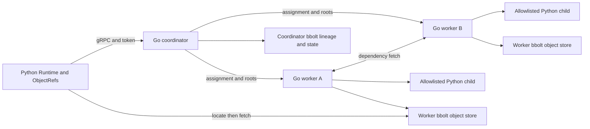
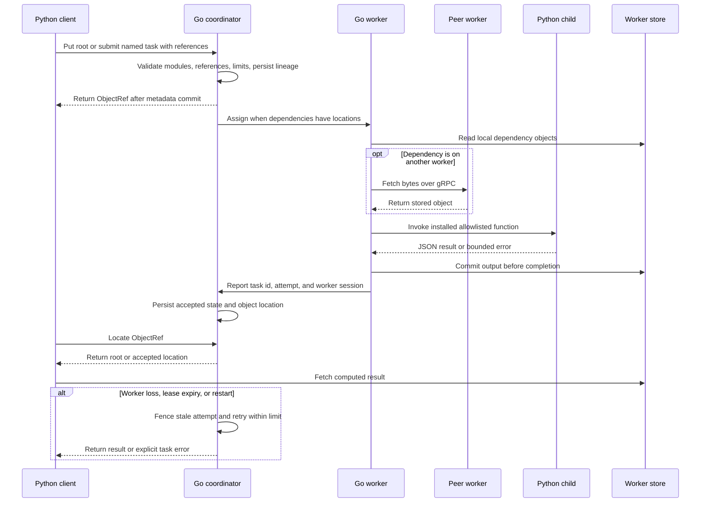

# Distributed task runtime

## Guide

- [Architecture and execution guide](#architecture-and-execution-guide)
- [Run the verified cluster](#run-the-verified-cluster)
- [How it works](#how-it-works)
- [Boundaries and limits](#boundaries-and-limits)
- [Checks](#checks)

The [initial hosted benchmark](docs/benchmarks/2026-10-22-initial.md) measured real gRPC DAGs at source `0a9aa3f`. At the base workload, median throughput over five runs was 5.184 DAG/s with one worker (range 4.945–5.220), 8.785 with two workers (7.166–9.366), and 11.362 with four workers (10.843–12.029). A separate 120-second run offered 4 DAG/s and finished all 480 exact results, with p50/p95/p99 latency of 338.6 / 445.7 / 639.2 ms. The 16 DAG/s sweep overloaded, finishing 97 of 160 and explicitly declining 63; it had zero product errors but a 13.30-second p99. Four visible hosted Linux cores, Python 3.11.17, Go 1.27.3, exact commands and raw receipt hashes are documented alongside every negative cell. Worker Python-child resources and native hot-path profiling remain gaps; no bottleneck or production-capacity claim follows.

The [frozen driver](.agents/skills/verify-distributed-task-runtime/features/benchmark.md) remains reproducible with `python tools/benchmark.py benchmark` on isolated Linux. `smoke` is a short correctness check and `profile` supplies separate diagnostics. Future load campaigns follow the established-framework revision of the metrics program.

The [matched rollback comparison](docs/benchmarks/2026-10-22-rollback.md) measured five interleaved pairs after native profiling identified duplicate state serialization. Median completed-work rate rose from 4.647 [4.621, 4.718] to 5.011 [4.967, 5.036] DAG/s on the same overloaded fixture. Both sides still declined many of the 160 offers, so neither passed the 16 DAG/s target. Exact results, zero product errors, negative load verdicts and sampled RSS costs remain documented. The candidate reuses the last durably committed snapshot for rollback; it preserves durable writes and response fencing. The completed full-candidate campaign is documented separately. The [profile notes](docs/benchmarks/native-profile-plan.md) also outline a future native k6 gRPC adapter.

The [full candidate campaign](docs/benchmarks/2026-10-22-full.md) retained 51 trials at source `77f28f2`. Five-repeat axis cells completed all 32 exact two-task DAGs per trial. A 120-second loopback run offered 4 DAG/s and completed all 480 with p50/p95/p99 end-to-end latency of 519.9 / 809.8 / 997.8 ms. The 16 DAG/s sweep completed 71 of 160 and declined 89, with zero task errors; the overall campaign verdict remains failed. Its four-core, single-host results are engineering screening evidence, not a production SLA or a six-node result. The [compact receipt audit](docs/benchmarks/2026-10-22-full.json) records counts, hashes and limitations.

A small Go/Python distributed futures runtime for studying task DAGs, object locality and recovery. A Go coordinator persists lineage and control metadata. Separate Go worker processes schedule local execution and own their object stores. Python provides `remote`, `ObjectRef`, `put` and `get`. Services and Python clients communicate through real gRPC HTTP/2 using the standard protobuf `Struct` message.

This is an independently written teaching implementation inspired by [Stanford CS244B's Baby Ray capstone](https://www.scs.stanford.edu/24sp-cs244b/projects/Baby_Ray_Re-implementing_a_distributed_Python_runtime_in_Go.pdf), listed in the [official 2024 course program](https://www.scs.stanford.edu/24sp-cs244b/labs/program.html), and [Ray's OSDI 2018 paper](https://www.usenix.org/conference/osdi18/presentation/moritz). No student repository code or history is incorporated. The original contribution here is durable publication and attempt fencing with repeatable coordinator/worker crash journeys. This does not claim course completion, production suitability or a distributed performance speedup.

## Run the verified cluster

Requirements are Go 1.27 and Python 3.11. The dependency versions are in `go.mod`, `go.sum` and `requirements.lock`. On Windows PowerShell:

```powershell
python -m venv .venv
.venv/Scripts/python.exe -m pip install -r requirements.lock
go build -o bin/runtime.exe ./cmd/runtime
.venv/Scripts/python.exe tools/verify.py
```

The driver owns isolated loopback ports, a temporary capability token, two worker stores and a coordinator database. It runs actual Python tasks, kills an assigned worker, restarts the coordinator, asserts the results and stops its process trees. It prints the retained `.runs/<run>/evidence.json` path. Evidence and process logs survive cleanup and are intentionally ignored by Git. The maintained [verification skill](.agents/skills/verify-distributed-task-runtime/SKILL.md) and [feature map](.agents/skills/verify-distributed-task-runtime/features/README.md) document these journeys.

For a manually managed cluster, set `TASK_RUNTIME_TOKEN` to a random capability of at least 24 characters in each process. Start one coordinator and two workers from this repository root, using the same Python environment with the same installed trusted functions:

```powershell
bin/runtime.exe -role coordinator -address 127.0.0.1:7100 -data .runs/manual/coordinator.db
bin/runtime.exe -role worker -id session-a -address 127.0.0.1:7101 -coordinator 127.0.0.1:7100 -data .runs/manual/a.db -python .venv/Scripts/python.exe
bin/runtime.exe -role worker -id session-b -address 127.0.0.1:7102 -coordinator 127.0.0.1:7100 -data .runs/manual/b.db -python .venv/Scripts/python.exe
```

Run each command in its own terminal. A worker ID names one object-store session; never reuse it for a different store. Restart the coordinator with its same database file. Start fresh clusters with fresh databases. The driver does not touch manually started processes.

```python
import os
from examples.functions import add, total
from taskruntime import Runtime

runtime = Runtime("127.0.0.1:7100", os.environ["TASK_RUNTIME_TOKEN"])
root = runtime.put(10)
left = runtime.remote(add).remote(root, 2)
right = runtime.remote(add).remote(root, 3)
joined = runtime.remote(total).remote([left, right], offset=5)
assert runtime.get(joined) == 30
```

Use `-modules package.functions,other.trusted_module` on coordinator and workers to allow your installed modules. The Python API validates call signatures before submission. Functions must be named top-level functions defined in the allowlisted module. Closures, source upload, pickle, eval, arbitrary imports requested by clients, actors, GPUs and ML frameworks are outside this runtime.

## How it works

`internal/cluster/coordinator.go` owns the task state machine. Submission creates an immutable task definition and output reference in one bbolt transaction. References must already exist, which prevents forward references and cycles. Nested list/dictionary arguments are scanned for dependencies. A task is dispatched only when every parent has an available object location or durable root input. Parent failures propagate to children.

Each worker polls for work and sends independent heartbeats every 300 ms. The coordinator chooses the idle worker with the most dependency objects, breaking ties by worker ID. A worker runs one task at a time. It resolves arguments from its bbolt object cache, fetches missing computed payloads directly from peer workers over gRPC, then invokes the trusted Python function in a child interpreter. Root cache keys use `root:<id>` and task outputs use `task:<id>:<attempt>`; legal IDs cannot contain `:`, so the namespaces and attempts cannot overlap. Computed payloads never transit the coordinator. The worker commits output bytes locally before announcing completion. Clients fetch accepted computed results directly from the owning worker.

Root inputs are deliberately retained in the coordinator's bbolt database and included in assignments. This enables lineage reconstruction after every worker store is lost. Root dispatch bytes are not counted as peer transfers. The `transfers` counter counts successful peer object fetches; it demonstrates placement behavior without claiming a speedup. The coordinator does not track opportunistic cache replicas, so placement uses accepted output ownership and may miss a cached copy.

The coordinator durably commits task attempt, assignment and state before replying. A completion must match the current task ID, attempt and worker session. A replay of an accepted completion is idempotent. Losing a worker heartbeat for two seconds removes its locations and requeues running tasks and lost completed outputs. Tasks get at most three attempts, a 15-second assignment lease, a 10-second worker execution budget, and an 8-second Python subprocess budget. Queued lineage expires after 60 seconds from submission. Failures terminate explicitly; `get` also has its own bounded deadline.

Coordinator restart reloads roots, lineage and accepted output locations. It requeues previously running tasks and rejects their old completions. Persisted nodes get a two-second heartbeat grace period, allowing accepted results on surviving stores to remain readable. This is one durable coordinator, not a replicated control plane or consensus system. Loss of its database is unrecoverable. Store loss after the three-attempt budget or 60-second queued-lineage lifetime ends in a reported failure.

## Boundaries and limits

- Trusted local teaching workloads only. Every service binds to a numeric loopback address and requires the shared capability token. Loopback transport is plaintext; possession of the token grants the same trusted cluster role. This is not a sandbox for hostile code or clients.
- Retry only deterministic pure tasks. Execution can happen more than once, including after coordinator restart. Side effects are not exactly once.
- JSON values only. Protobuf Struct uses binary64 numbers, so values must be finite and within `2**53 - 1`. Integer/float identity, tuples and custom Python types are not preserved.
- Objects and root batches are limited to 1 MiB, RPC messages to 2 MiB, task specifications to 256 KiB, argument/value nesting to 32 and task dependencies to 128. Objects must also fit a protobuf response; task submissions check their serialized assignment with reserved room for bounded owner metadata. Protobuf may be larger than JSON, so a batch within the JSON limit can still be rejected before acceptance. Replies are serialized and checked before metadata commits. A cluster accepts at most 10,000 tasks and 10,000 roots. `Status` is a teaching snapshot without pagination; sufficiently large metadata snapshots can exceed the RPC cap and return an explicit size error.
- Worker stores retain attempt objects for the cluster lifetime. There is no garbage collector, spill policy, cancellation API, dynamic code distribution, node capacity model or multi-host support. Use isolated scratch databases for bounded exercises.
- Python children execute with the worker's user permissions. The verification driver terminates its owned Windows process trees; operators must similarly stop a worker's children when manually forcing it down.

## Checks

```powershell
go test ./...
go vet ./...
go build -o bin/runtime.exe ./cmd/runtime
.venv/Scripts/python.exe -m unittest discover -s tests -v
.venv/Scripts/python.exe tools/verify.py
go run golang.org/x/vuln/cmd/govulncheck@v1.9.0 ./...
.venv/Scripts/python.exe -m pip_audit -r requirements.lock
```

The optional Python audit tool used during development is `pip-audit==2.10.1`; install it in the venv when rerunning that check. It is not required by the runtime. Go's race detector needs a C compiler/CGO and was unavailable in the Windows validation environment. Build, vet, focused state-machine tests, Python tests and the real process driver are separate checks.

`.github/workflows/ci.yml` runs those checks on Windows with Go 1.27.3 and Python 3.11, then retains `.runs/` evidence for seven days, including failed runs. Official GitHub actions are pinned by commit SHA and the workflow has read-only repository permissions. The workflow was checked locally with `actionlint v1.7.11` and its product commands were executed locally; a hosted CI run requires publication and has not been triggered from this checkout.

Dependency provenance and the security update are recorded in [THIRD_PARTY.md](THIRD_PARTY.md). Source is MIT licensed.

## Architecture and execution guide

This repository implements a teaching distributed-futures runtime: a Python client, Go coordinator, Go workers, and child Python interpreters for allowlisted installed functions. It uses gRPC and protobuf libraries; it does not implement a replicated coordinator, hostile-code sandbox, or exactly-once side effects. An [ObjectRef](#object-ref) names a root value or task result.

The client submits task definitions and [ObjectRefs](#object-ref) to the coordinator as a [task DAG](#task-dag). Workers fetch dependencies from local or peer [object locations](#object-location), invoke a [trusted function](#trusted-function), commit output locally, then announce the accepted attempt. The coordinator makes metadata [durable before response](#durable-before-response) and uses [attempt fencing](#attempt-fencing).



The coordinator persists task lineage and attempt ownership before acknowledging. A worker stores result bytes before completion; clients locate results through the coordinator and fetch computed bytes from their owner.



| Subsystem | Responsibility and owned state | Source |
|---|---|---|
| Python API | Value validation, submission, future references, locate and fetch | [`client.py`](taskruntime/client.py) |
| Coordinator | Durable lineage, heartbeats, leases, attempts, accepted object locations | [`coordinator.go`](internal/cluster/coordinator.go), [`model.go`](internal/cluster/model.go) |
| Worker execution | Dependency resolution, peer fetch, local objects, Python invocation | [`worker.go`](internal/cluster/worker.go), [`worker_exec.py`](taskruntime/worker_exec.py) |
| Wire service | Protobuf conversion, loopback, token authentication, message limits | [`wire.go`](internal/wire/wire.go) |
| Process entry point | Starts one coordinator or worker role | [`main.go`](cmd/runtime/main.go) |

### Task journey

1. Create a `Runtime`, store JSON-compatible roots, and decorate an installed top-level function with `remote`.
2. Submit tasks that reference earlier objects. The client checks signatures; the coordinator validates allowlists, references, cycles, and limits before persisting lineage.
3. The coordinator schedules ready work by object locations. Workers read local inputs or fetch computed values from peers, then invoke Python child processes.
4. Workers commit outputs before reporting completion. The coordinator accepts only the current task attempt and session; `get` locates then fetches the result.
5. Worker loss, lease expiry, or coordinator restart can reschedule within three attempts. Stale completions are rejected. Side effects can repeat.

### Design decisions and tradeoffs

These rationales are inferred from implementation.

| Choice | Practical reason | Alternative and cost to reconsider |
|---|---|---|
| One durable coordinator owns metadata | Restart reconstructs roots and lineage without consensus | Replicate metadata, requiring leader election and consistent commits |
| Computed bytes stay on workers and transfer peer-to-peer | Coordinator tracks locations without relaying payloads | Route all bytes through coordinator, adding a central data path |
| Commit worker output before reporting | Accepted metadata does not point to missing output | Report first and risk publishing before a crash loses bytes |
| Fence completion by task, attempt, and session | Retries cannot let stale workers overwrite accepted state | Accept by task ID alone and permit late publication |
| Retry bounded computations, not effects | Crash recovery works for pure tasks | Promise exactly-once side effects, which this protocol cannot provide |
| Use protobuf Struct and JSON values | Keeps the wire model inspectable and bounded | Preserve arbitrary Python objects, needing a larger serialization contract |

### Glossary

<a id="object-ref"></a>

<details><summary>What is an ObjectRef?</summary>

It is a client-visible identifier for a root or task result. `remote(add).remote(root, 2)` returns one before the result is fetched.

</details>

<a id="task-dag"></a>

<details><summary>What is a task DAG?</summary>

It is a directed acyclic graph of computations and dependencies. Existing references are required at submission, preventing forward references and cycles.

</details>

<a id="attempt-fencing"></a>

<details><summary>What is attempt fencing?</summary>

It accepts completion only from the current task attempt and worker session. A completion from an earlier lease is rejected after retry or restart.

</details>

<a id="object-location"></a>

<details><summary>What is an object location?</summary>

It identifies the worker store and key that hold computed bytes. The client fetches the result directly from the accepted owner.

</details>

<a id="durable-before-response"></a>

<details><summary>What does durable-before-response mean?</summary>

It means task metadata is written to bbolt before submission or accepted completion is acknowledged. It does not replicate that database.

</details>

<a id="trusted-function"></a>

<details><summary>What is a trusted function?</summary>

It is an installed top-level function in a module operators allowlist on workers. Clients cannot upload source or request arbitrary imports.

</details>
