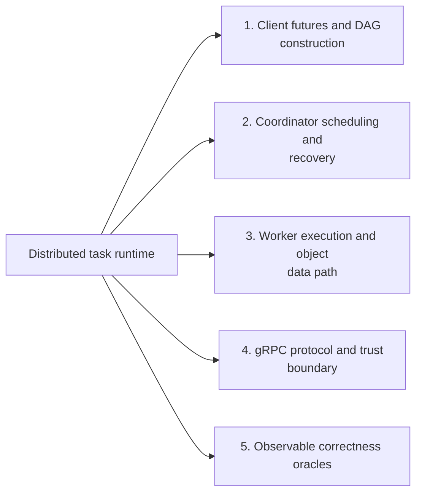
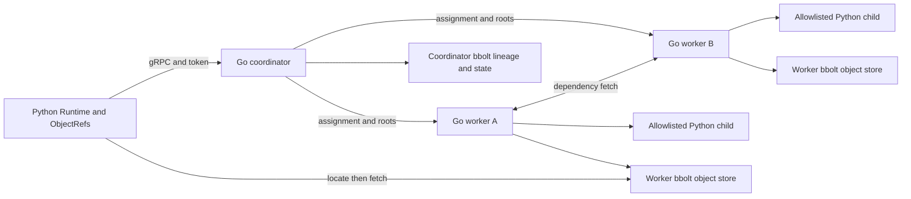
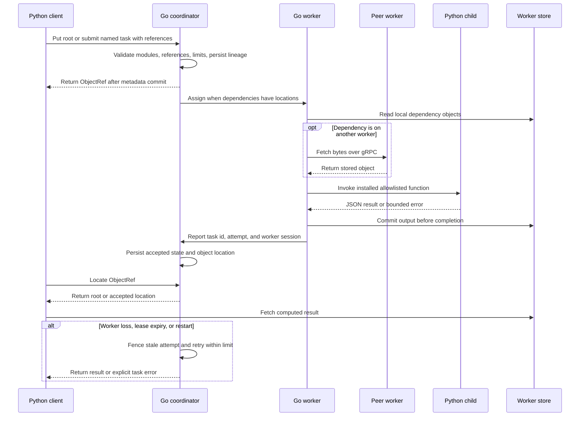

# Distributed task runtime

## Architecture and execution guide

### Subsystem map

Select a subsystem in the diagram to open its techniques, tradeoffs, and code references. The numbered links provide the same navigation. This map groups components; the execution diagrams show their runtime flow.



1. [Client futures and DAG construction](#subsystem-client-futures-and-dag-construction)
2. [Coordinator scheduling and recovery](#subsystem-coordinator-scheduling-and-recovery)
3. [Worker execution and object data path](#subsystem-worker-execution-and-object-data-path)
4. [gRPC protocol and trust boundary](#subsystem-grpc-protocol-and-trust-boundary)
5. [Observable correctness oracles](#subsystem-observable-correctness-oracles)

This repository implements a teaching distributed-futures runtime: a Python client, Go coordinator, Go workers, and child Python interpreters for allowlisted installed functions. It uses gRPC and protobuf libraries; it does not implement a replicated coordinator, hostile-code sandbox, or exactly-once side effects. An [ObjectRef](#object-ref) names a root value or task result.

The client submits task definitions and [ObjectRefs](#object-ref) to the coordinator as a [task DAG](#task-dag). Workers fetch dependencies from local or peer [object locations](#object-location), invoke a [trusted function](#trusted-function), commit output locally, then announce the accepted attempt. The coordinator makes metadata [durable before response](#durable-before-response) and uses [attempt fencing](#attempt-fencing).

<details>
<summary>Expand flow diagram 1</summary>



</details>

The coordinator persists task lineage and attempt ownership before acknowledging. A worker stores result bytes before completion; clients locate results through the coordinator and fetch computed bytes from their owner.

<details>
<summary>Expand flow diagram 2</summary>



</details>

| Subsystem | Responsibility and owned state | Source |
|---|---|---|
| Python API | Value validation, submission, future references, locate and fetch | [`client.py`](taskruntime/client.py) |
| Coordinator | Durable lineage, heartbeats, leases, attempts, accepted object locations | [`coordinator.go`](internal/cluster/coordinator.go), [`model.go`](internal/cluster/model.go) |
| Worker execution | Dependency resolution, peer fetch, local objects, Python invocation | [`worker.go`](internal/cluster/worker.go), [`worker_exec.py`](taskruntime/worker_exec.py) |
| Wire service | Protobuf conversion, loopback, token authentication, message limits | [`wire.go`](internal/wire/wire.go) |
| Process entry point | Starts one coordinator or worker role | [`main.go`](cmd/runtime/main.go) |

### Task journey

1. Create a `Runtime`, store JSON-compatible roots, and decorate an installed top-level function with `remote`.
2. Submit tasks that reference earlier objects. The client checks signatures; the coordinator validates allowlists, references, cycles, and limits before persisting lineage.
3. The coordinator schedules ready work by object locations. Workers read local inputs or fetch computed values from peers, then invoke Python child processes.
4. Workers commit outputs before reporting completion. The coordinator accepts only the current task attempt and session; `get` locates then fetches the result.
5. Worker loss, lease expiry, or coordinator restart can reschedule within three attempts. Stale completions are rejected. Side effects can repeat.

### Design decisions and tradeoffs

These rationales are inferred from implementation.

| Choice | Practical reason | Alternative and cost to reconsider |
|---|---|---|
| One durable coordinator owns metadata | Restart reconstructs roots and lineage without consensus | Replicate metadata, requiring leader election and consistent commits |
| Computed bytes stay on workers and transfer peer-to-peer | Coordinator tracks locations without relaying payloads | Route all bytes through coordinator, adding a central data path |
| Commit worker output before reporting | Accepted metadata does not point to missing output | Report first and risk publishing before a crash loses bytes |
| Fence completion by task, attempt, and session | Retries cannot let stale workers overwrite accepted state | Accept by task ID alone and permit late publication |
| Retry bounded computations, not effects | Crash recovery works for pure tasks | Promise exactly-once side effects, which this protocol cannot provide |
| Use protobuf Struct and JSON values | Keeps the wire model inspectable and bounded | Preserve arbitrary Python objects, needing a larger serialization contract |

### Glossary

<a id="object-ref"></a>

<details><summary>What is an ObjectRef?</summary>

It is a client-visible identifier for a root or task result. `remote(add).remote(root, 2)` returns one before the result is fetched.

</details>

<a id="task-dag"></a>

<details><summary>What is a task DAG?</summary>

It is a directed acyclic graph of computations and dependencies. Existing references are required at submission, preventing forward references and cycles.

</details>

<a id="attempt-fencing"></a>

<details><summary>What is attempt fencing?</summary>

It accepts completion only from the current task attempt and worker session. A completion from an earlier lease is rejected after retry or restart.

</details>

<a id="object-location"></a>

<details><summary>What is an object location?</summary>

It identifies the worker store and key that hold computed bytes. The client fetches the result directly from the accepted owner.

</details>

<a id="durable-before-response"></a>

<details><summary>What does durable-before-response mean?</summary>

It means task metadata is written to bbolt before submission or accepted completion is acknowledged. It does not replicate that database.

</details>

<a id="trusted-function"></a>

<details><summary>What is a trusted function?</summary>

It is an installed top-level function in a module operators allowlist on workers. Clients cannot upload source or request arbitrary imports.

</details>

## Implementation techniques

This section covers active client, coordinator, worker, persistence, subprocess, protocol, and authentication paths; rationale is inferred from current code.

<details>
<summary>Full technique index</summary>

| Active subsystem | Technique cards | Source files |
|---|---|---|
| Client futures and DAG construction | [Future reference encoding](#technique-future-reference-encoding), [DAG dependency extraction and readiness](#technique-dag-dependency-extraction-and-readiness), [JSON and protobuf conversion with size checks](#technique-bounded-json-and-protobuf-boundary), [Deadline-bounded polling](#technique-deadline-bounded-polling) | `taskruntime/client.py`, `internal/cluster/model.go` |
| Coordinator scheduling and recovery | [Data-locality scheduling](#technique-data-locality-scheduling), [Durable commit before acknowledgement](#technique-durable-commit-before-acknowledgement), [Attempt fencing and bounded retries](#technique-attempt-fencing-and-bounded-retries), [Worker heartbeat and lease expiry](#technique-worker-heartbeat-and-lease-expiry), [Committed snapshot rollback](#technique-committed-snapshot-rollback) | `internal/cluster/coordinator.go`, `internal/cluster/model.go` |
| Worker execution and object data path | [Persistent local objects and peer fetch](#technique-persistent-local-objects-and-peer-fetch), [Trusted installed-function subprocess](#technique-trusted-installed-function-subprocess), [Layered execution deadlines and output budgets](#technique-layered-execution-deadlines-and-output-budgets) | `internal/cluster/worker.go`, `taskruntime/worker_exec.py` |
| gRPC protocol and trust boundary | [JSON and protobuf conversion with size checks](#technique-bounded-json-and-protobuf-boundary), [Loopback capability authentication](#technique-loopback-capability-authentication) | `internal/wire/wire.go`, `protocol/runtime.proto`, `cmd/runtime/main.go` |
| Observable correctness oracles | [DAG, recovery, and failure assertions](#technique-dag-recovery-and-failure-assertions) | `internal/cluster/coordinator_test.go`, `internal/wire/wire_test.go`, `tests/test_client.py` |

</details>

<a id="subsystem-client-futures-and-dag-construction"></a>

### 1. Client futures and DAG construction

[Back to the subsystem map](#architecture-and-execution-guide).

**Code.** [`taskruntime/client.py`](taskruntime/client.py), [`internal/cluster/model.go`](internal/cluster/model.go), [`internal/cluster/coordinator.go`](internal/cluster/coordinator.go).

**Techniques.** [Future reference encoding](#technique-future-reference-encoding), [DAG dependency extraction and readiness](#technique-dag-dependency-extraction-and-readiness), [JSON and protobuf conversion with size checks](#technique-bounded-json-and-protobuf-boundary), [Deadline-bounded polling](#technique-deadline-bounded-polling).

**Related concepts.** [ObjectRef](#object-ref).

<a id="technique-future-reference-encoding"></a>

<details>
<summary>Future reference encoding</summary>

**Mechanism.** `ObjectRef` carries an ID rather than a value. `encode` recursively converts references nested in lists and dictionaries to tagged argument records; `Remote.remote` submits the function name and those records, then returns the reference without waiting for execution.

**Example.** `remote(total).remote([left, right])` sends a list argument containing two reference tags and returns a new `ObjectRef`.

**Why here.** Callers can describe branching and joined computations with ordinary Python containers while results remain distributed.

**Tradeoffs.** References name runtime objects; they do not make arbitrary Python values serializable. The wire representation also imposes nesting and dependency limits.

**Code and ownership.** [`ObjectRef`, `encode`, and `Remote.remote`](taskruntime/client.py#L48), extension.


**Used in.** [Client futures and DAG construction](#subsystem-client-futures-and-dag-construction). [Back to the subsystem map](#architecture-and-execution-guide).

</details>

<a id="technique-dag-dependency-extraction-and-readiness"></a>

<details>
<summary>DAG dependency extraction and readiness</summary>

**Mechanism.** `dependencies` recursively visits tagged arguments and collects reference IDs from nested lists and dictionaries. Submission checks that every ID exists, sorts the unique parents, then polling waits until each root or computed parent has an available location. Requiring existing references prevents forward edges and cycles.

**Example.** A task with `{"values": [refA, refB]}` records both parents; it becomes ready only when both root bytes or accepted locations are available.

**Why here.** The coordinator can make readiness decisions from explicit lineage and object-location metadata.

**Tradeoffs.** This only models references in the supported JSON-shaped argument tree. Nesting and dependency counts are bounded, and failed parents propagate failure to dependents.

**Code and ownership.** [`dependencies`](internal/cluster/model.go#L84) and submission/readiness in [`handle`](internal/cluster/coordinator.go#L167), extension.


**Used in.** [Client futures and DAG construction](#subsystem-client-futures-and-dag-construction). [Back to the subsystem map](#architecture-and-execution-guide).

</details>

<a id="technique-bounded-json-and-protobuf-boundary"></a>

<details>
<summary>JSON and protobuf conversion with size checks</summary>

**Mechanism.** The Python client accepts finite JSON-compatible values with string dictionary keys and bounded nesting. Go converts requests through JSON into protobuf `Struct` maps and back; the gRPC server and clients cap messages at 2 MiB. Object and root batches are limited to 1 MiB, task specs to 256 KiB, and submissions check the serialized protobuf assignment plus reserved owner metadata before publishing it.

**Example.** A JSON object that fits 1 MiB but expands beyond the assignment RPC budget is rejected before task and object metadata are inserted.

**Why here.** A shared JSON-shaped value model crosses Python, Go and protobuf without pickle or arbitrary object encoding.

**Tradeoffs.** `Struct` numbers are binary64, so integer precision is bounded; tuples and custom types are not preserved. Protobuf overhead means a value under its JSON cap may still fail the transport budget.

**Code and ownership.** [`validate` and `rpc`](taskruntime/client.py#L16), [`Message`, `Decode`, and size checks](internal/wire/wire.go#L25), protobuf `Struct` schema in [`runtime.proto`](protocol/runtime.proto#L1), mixed extension and protobuf dependency.


**Used in.** [Client futures and DAG construction](#subsystem-client-futures-and-dag-construction), [gRPC protocol and trust boundary](#subsystem-grpc-protocol-and-trust-boundary). [Back to the subsystem map](#architecture-and-execution-guide).

</details>

<a id="technique-deadline-bounded-polling"></a>

<details>
<summary>Deadline-bounded polling</summary>

**Mechanism.** `Runtime.get` computes a monotonic deadline, repeatedly locates the object, fetches it from an accepted owner when done, and bounds each RPC timeout by the remaining caller budget. It retries only unavailable or deadline-exceeded RPC errors and pauses briefly between attempts.

**Example.** With a 150 ms timeout and an unreachable coordinator, `get` raises `TimeoutError` instead of polling forever.

**Why here.** Result retrieval must return within the caller's requested wait budget even while workers or coordinator are unavailable.

**Tradeoffs.** Polling adds repeated locate calls and the caller's timeout does not cancel submitted work. Other RPC error classes surface immediately.

**Code and ownership.** [`Runtime.get`](taskruntime/client.py#L103), extension.


**Used in.** [Client futures and DAG construction](#subsystem-client-futures-and-dag-construction). [Back to the subsystem map](#architecture-and-execution-guide).

</details>

<a id="subsystem-coordinator-scheduling-and-recovery"></a>

### 2. Coordinator scheduling and recovery

[Back to the subsystem map](#architecture-and-execution-guide).

**Code.** [`internal/cluster/coordinator.go`](internal/cluster/coordinator.go), [`internal/cluster/model.go`](internal/cluster/model.go), [`internal/cluster/worker.go`](internal/cluster/worker.go).

**Techniques.** [Data-locality scheduling](#technique-data-locality-scheduling), [Durable commit before acknowledgement](#technique-durable-commit-before-acknowledgement), [Attempt fencing and bounded retries](#technique-attempt-fencing-and-bounded-retries), [Worker heartbeat and lease expiry](#technique-worker-heartbeat-and-lease-expiry), [Committed snapshot rollback](#technique-committed-snapshot-rollback).

**Related concepts.** [attempt fencing](#attempt-fencing), [object location](#object-location).

<a id="technique-data-locality-scheduling"></a>

<details>
<summary>Data-locality scheduling</summary>

**Mechanism.** Polling considers queued tasks whose dependencies are available, then scores idle workers by how many computed dependency objects they already own. The highest score wins; worker ID breaks ties. Root inputs travel in the assignment and are cached locally, while computed objects can be fetched from peers.

**Example.** If worker A has two of a task's three computed inputs and worker B has none, A is selected; it fetches only the missing value.

**Why here.** Computed payloads move directly between worker stores, so placement near dependencies can reduce some peer fetches.

**Tradeoffs.** The score uses accepted ownership metadata, not opportunistic cache copies or worker capacity. It is a heuristic and makes no speedup guarantee.

**Code and ownership.** Worker selection in [`Coordinator.handle`](internal/cluster/coordinator.go#L167), extension.


**Used in.** [Coordinator scheduling and recovery](#subsystem-coordinator-scheduling-and-recovery). [Back to the subsystem map](#architecture-and-execution-guide).

</details>

<a id="technique-durable-commit-before-acknowledgement"></a>

<details>
<summary>Durable commit before acknowledgement</summary>

**Mechanism.** Coordinator calls mutate the in-memory state, serialize the reply and enforce its protobuf budget, then save the state in one bbolt update before returning success. A failed validation, encoding, size check, or commit restores the last committed state. Worker output bytes are stored locally before the worker reports completion; accepted locations are committed with coordinator state.

**Example.** `put` returns an ID only after its root value is durable; a task result is not discoverable until its owner has stored the bytes and the coordinator accepts completion.

**Why here.** Acknowledged metadata does not point to a root or output that failed to commit locally.

**Tradeoffs.** The coordinator database is a single durable copy, not replicated consensus state. Worker store loss can make computed values unavailable and trigger bounded reconstruction attempts.

**Code and ownership.** [`Coordinator.Call` and `save`](internal/cluster/coordinator.go#L68), with output persistence in [`Worker.store`](internal/cluster/worker.go#L42), extension.


**Used in.** [Coordinator scheduling and recovery](#subsystem-coordinator-scheduling-and-recovery). [Back to the subsystem map](#architecture-and-execution-guide).

</details>

<a id="technique-attempt-fencing-and-bounded-retries"></a>

<details>
<summary>Attempt fencing and bounded retries</summary>

**Mechanism.** Each assignment increments and persists the task attempt and binds it to a worker session. Completion must match task ID, attempt and current session; stale attempts are rejected. Worker completion requests replay the same completion after uncertain responses, and coordinator restart requeues running work with an incremented attempt on reassignment. Retries stop at three attempts.

**Example.** If attempt 1 finishes after restart has queued the task and attempt 2 is assigned, completion from attempt 1 cannot publish its location.

**Why here.** Worker or coordinator failures can leave an earlier execution running while replacement work begins.

**Tradeoffs.** Execution may happen more than once, so side effects can repeat. Fencing controls publication, not execution, and does not promise exactly-once external effects.

**Code and ownership.** [`Coordinator.retry` and completion handling](internal/cluster/coordinator.go#L79), plus completion replay in [`Worker.Run`](internal/cluster/worker.go#L62), extension.


**Used in.** [Coordinator scheduling and recovery](#subsystem-coordinator-scheduling-and-recovery). [Back to the subsystem map](#architecture-and-execution-guide).

</details>

<a id="technique-worker-heartbeat-and-lease-expiry"></a>

<details>
<summary>Worker heartbeat and lease expiry</summary>

**Mechanism.** A worker sends heartbeats every 300 ms while polling for tasks. Coordinator expiration removes sessions silent for two seconds, clears their object locations and retries their running work. Running assignments also have a 15-second lease; queued lineage expires after 60 seconds.

**Example.** If a worker stops heartbeating, its accepted locations are invalidated and downstream work waits for reconstructed outputs or fails within its retry/deadline bounds.

**Why here.** These timers let the coordinator detect process loss and bound how long abandoned work remains eligible.

**Tradeoffs.** Heartbeats are liveness evidence, not proof that a worker's task is progressing. Timeout-based recovery can overlap execution, so attempt fencing remains necessary.

**Code and ownership.** [`Worker.Run`](internal/cluster/worker.go#L62) and [`Coordinator.expire`](internal/cluster/coordinator.go#L89), extension.


**Used in.** [Coordinator scheduling and recovery](#subsystem-coordinator-scheduling-and-recovery). [Back to the subsystem map](#architecture-and-execution-guide).

</details>

<a id="technique-committed-snapshot-rollback"></a>

<details>
<summary>Committed snapshot rollback</summary>

**Mechanism.** After each successful bbolt save, the coordinator retains the exact serialized state bytes in `committed`. If a later state save fails, it unmarshals that snapshot rather than serializing the previous state again. The periodic expiration loop uses the same snapshot on commit failure.

**Example.** A closed database makes a new `put` fail; the coordinator restores the prior committed map and the failed object remains absent.

**Why here.** This is the implemented response to duplicate state serialization on rollback paths while retaining durable-before-response behavior.

**Tradeoffs.** The snapshot is a second in-memory copy of serialized metadata and is replaced on every successful commit. It does not reduce the normal commit's marshal or database write.

**Code and ownership.** [`Coordinator.save`, `Call`, and `Run`](internal/cluster/coordinator.go#L68), extension.


**Used in.** [Coordinator scheduling and recovery](#subsystem-coordinator-scheduling-and-recovery). [Back to the subsystem map](#architecture-and-execution-guide).

</details>

<a id="subsystem-worker-execution-and-object-data-path"></a>

### 3. Worker execution and object data path

[Back to the subsystem map](#architecture-and-execution-guide).

**Code.** [`internal/cluster/worker.go`](internal/cluster/worker.go), [`taskruntime/worker_exec.py`](taskruntime/worker_exec.py).

**Techniques.** [Persistent local objects and peer fetch](#technique-persistent-local-objects-and-peer-fetch), [Trusted installed-function subprocess](#technique-trusted-installed-function-subprocess), [Layered execution deadlines and output budgets](#technique-layered-execution-deadlines-and-output-budgets).

<a id="technique-persistent-local-objects-and-peer-fetch"></a>

<details>
<summary>Persistent local objects and peer fetch</summary>

**Mechanism.** Each worker stores root inputs and computed attempt outputs in its local bbolt object bucket. Execution first checks its local key, then caches assigned root bytes, or tries the listed peer locations until a computed dependency fetch succeeds. Only successful peer fetches increment the transfer count. Clients locate accepted results through the coordinator and fetch bytes directly from the owner.

**Example.** A worker reads a root locally, fetches a parent's `task:<id>:<attempt>` value from another worker, stores a local copy, then resolves the function arguments.

**Why here.** The coordinator can own control metadata without relaying computed object payloads.

**Tradeoffs.** Worker stores have no garbage collector or replica directory. A missing owning store can make data unavailable; a cached copy unknown to the coordinator does not help placement.

**Code and ownership.** [`Worker.load`, `store`, and `execute`](internal/cluster/worker.go#L30), extension.


**Used in.** [Worker execution and object data path](#subsystem-worker-execution-and-object-data-path). [Back to the subsystem map](#architecture-and-execution-guide).

</details>

<a id="technique-trusted-installed-function-subprocess"></a>

<details>
<summary>Trusted installed-function subprocess</summary>

**Mechanism.** The Go worker starts a Python child for each task, sends a JSON request over stdin, and invokes a named function only if its module is allowlisted and the function is a top-level function defined by that module. It binds the signature before calling and redirects task stdout away from the machine-readable result channel.

**Example.** The child imports `examples.functions`, checks the named `add` function, calls it with decoded arguments and writes one JSON result record.

**Why here.** Python callers can execute installed Python functions while Go owns assignment, object storage and process scheduling.

**Tradeoffs.** Modules must already be installed and allowlisted on each worker. The child has the worker OS user's permissions; this is not isolation for hostile code, and functions can run again after retries.

**Code and ownership.** [`Worker.execute`](internal/cluster/worker.go#L108) and [`worker_exec.main`](taskruntime/worker_exec.py#L11), extension.


**Used in.** [Worker execution and object data path](#subsystem-worker-execution-and-object-data-path). [Back to the subsystem map](#architecture-and-execution-guide).

</details>

<a id="technique-layered-execution-deadlines-and-output-budgets"></a>

<details>
<summary>Layered execution deadlines and output budgets</summary>

**Mechanism.** The coordinator gives each assignment a 15-second lease, worker execution gets a 10-second context, and the Python child gets an 8-second context. RPCs use a three-second timeout, while `Runtime.get` polls until its caller deadline and caps each locate/fetch call to the remaining time. Python output and task error text are bounded before crossing back into runtime state.

**Example.** A blocked Python function is terminated when the child context expires; a caller with a shorter `get` timeout stops polling before the longer task lifecycle bound.

**Why here.** Independent limits bound abandoned work, RPC waits, result/error data and caller waiting.

**Tradeoffs.** These are separate budgets; a caller timeout does not cancel submitted work. A timeout can cause a retry while an earlier operation's external side effects have already occurred.

**Code and ownership.** [`Worker.execute`](internal/cluster/worker.go#L108), [`rpc` and `Runtime.get`](taskruntime/client.py#L36), extension.


**Used in.** [Worker execution and object data path](#subsystem-worker-execution-and-object-data-path). [Back to the subsystem map](#architecture-and-execution-guide).

</details>

<a id="subsystem-grpc-protocol-and-trust-boundary"></a>

### 4. gRPC protocol and trust boundary

[Back to the subsystem map](#architecture-and-execution-guide).

**Code.** [`internal/wire/wire.go`](internal/wire/wire.go), [`protocol/runtime.proto`](protocol/runtime.proto), [`cmd/runtime/main.go`](cmd/runtime/main.go).

**Techniques.** [Loopback capability authentication](#technique-loopback-capability-authentication).

**Shared techniques.** [JSON and protobuf conversion with size checks](#technique-bounded-json-and-protobuf-boundary).

<a id="technique-loopback-capability-authentication"></a>

<details>
<summary>Loopback capability authentication</summary>

**Mechanism.** Process startup and the wire layer accept numeric IPv4 or IPv6 loopback addresses with a valid nonzero port. The gRPC server requires exactly one authorization metadata value and compares it to the configured token in constant time; clients attach the same shared capability to each call.

**Example.** A peer at `127.0.0.1:7101` with the shared token can fetch an object; a non-loopback address or absent/incorrect token is rejected.

**Why here.** The runtime targets trusted local clusters and restricts both service binding and peer calls to that boundary.

**Tradeoffs.** Transport is plaintext and every holder of the shared token has the same cluster role. This is not a hostile-client or multi-host security design.

**Code and ownership.** [`Loopback`, `Serve`, and `Call`](internal/wire/wire.go#L95) and startup checks in [`main`](cmd/runtime/main.go#L15), extension over gRPC dependency.


**Used in.** [gRPC protocol and trust boundary](#subsystem-grpc-protocol-and-trust-boundary). [Back to the subsystem map](#architecture-and-execution-guide).

</details>

<a id="subsystem-observable-correctness-oracles"></a>

### 5. Observable correctness oracles

[Back to the subsystem map](#architecture-and-execution-guide).

**Code.** [`internal/cluster/coordinator_test.go`](internal/cluster/coordinator_test.go), [`internal/wire/wire_test.go`](internal/wire/wire_test.go), [`tests/test_client.py`](tests/test_client.py).

**Techniques.** [DAG, recovery, and failure assertions](#technique-dag-recovery-and-failure-assertions).

<a id="technique-dag-recovery-and-failure-assertions"></a>

<details>
<summary>DAG, recovery, and failure assertions</summary>

**Mechanism.** Focused tests assert externally visible states across coordinator reopen, stale completion, duplicate completion, attempt exhaustion, parent-failure propagation, lost output, invalid input, protobuf budget rejection, worker-store reopen, loopback validation and caller deadlines. They check exact results or named failure conditions, not throughput claims.

**Example.** `TestDurableLineageFencesOldAssignment` reopens metadata, verifies the old attempt is rejected, confirms the next attempt increments, and checks replayed completion is counted once.

**Why here.** Recovery and error semantics are central user-visible behavior for a runtime that reassigns work after process loss.

**Tradeoffs.** Unit-level state and boundary assertions do not replace the separate real-process cluster verification documented above.

**Code and ownership.** [`coordinator_test.go`](internal/cluster/coordinator_test.go#L44), [`wire_test.go`](internal/wire/wire_test.go#L14), and [`test_client.py`](tests/test_client.py#L8), extension.


**Used in.** [Observable correctness oracles](#subsystem-observable-correctness-oracles). [Back to the subsystem map](#architecture-and-execution-guide).

</details>

## Guide

- [Implementation techniques](#implementation-techniques)
- [Architecture and execution guide](#architecture-and-execution-guide)
- [Run the verified cluster](#run-the-verified-cluster)
- [How it works](#how-it-works)
- [Boundaries and limits](#boundaries-and-limits)
- [Checks](#checks)

The [initial hosted benchmark](docs/benchmarks/2026-10-22-initial.md) measured real gRPC DAGs at source `0a9aa3f`. At the base workload, median throughput over five runs was 5.184 DAG/s with one worker (range 4.945–5.220), 8.785 with two workers (7.166–9.366), and 11.362 with four workers (10.843–12.029). A separate 120-second run offered 4 DAG/s and finished all 480 exact results, with p50/p95/p99 latency of 338.6 / 445.7 / 639.2 ms. The 16 DAG/s sweep overloaded, finishing 97 of 160 and explicitly declining 63; it had zero product errors but a 13.30-second p99. Four visible hosted Linux cores, Python 3.11.17, Go 1.27.3, exact commands and raw receipt hashes are documented alongside every negative cell. Worker Python-child resources and native hot-path profiling remain gaps; no bottleneck or production-capacity claim follows.

The [frozen driver](.agents/skills/verify-distributed-task-runtime/features/benchmark.md) remains reproducible with `python tools/benchmark.py benchmark` on isolated Linux. `smoke` is a short correctness check and `profile` supplies separate diagnostics. Future load campaigns follow the established-framework revision of the metrics program.

The [matched rollback comparison](docs/benchmarks/2026-10-22-rollback.md) measured five interleaved pairs after native profiling identified duplicate state serialization. Median completed-work rate rose from 4.647 [4.621, 4.718] to 5.011 [4.967, 5.036] DAG/s on the same overloaded fixture. Both sides still declined many of the 160 offers, so neither passed the 16 DAG/s target. Exact results, zero product errors, negative load verdicts and sampled RSS costs remain documented. The candidate reuses the last durably committed snapshot for rollback; it preserves durable writes and response fencing. The completed full-candidate campaign is documented separately. The [profile notes](docs/benchmarks/native-profile-plan.md) also outline a future native k6 gRPC adapter.

The [full candidate campaign](docs/benchmarks/2026-10-22-full.md) retained 51 trials at source `77f28f2`. Five-repeat axis cells completed all 32 exact two-task DAGs per trial. A 120-second loopback run offered 4 DAG/s and completed all 480 with p50/p95/p99 end-to-end latency of 519.9 / 809.8 / 997.8 ms. The 16 DAG/s sweep completed 71 of 160 and declined 89, with zero task errors; the overall campaign verdict remains failed. Its four-core, single-host results are engineering screening evidence, not a production SLA or a six-node result. The [compact receipt audit](docs/benchmarks/2026-10-22-full.json) records counts, hashes and limitations.

A small Go/Python distributed futures runtime for studying task DAGs, object locality and recovery. A Go coordinator persists lineage and control metadata. Separate Go worker processes schedule local execution and own their object stores. Python provides `remote`, `ObjectRef`, `put` and `get`. Services and Python clients communicate through real gRPC HTTP/2 using the standard protobuf `Struct` message.

This is an independently written teaching implementation inspired by [Stanford CS244B's Baby Ray capstone](https://www.scs.stanford.edu/24sp-cs244b/projects/Baby_Ray_Re-implementing_a_distributed_Python_runtime_in_Go.pdf), listed in the [official 2024 course program](https://www.scs.stanford.edu/24sp-cs244b/labs/program.html), and [Ray's OSDI 2018 paper](https://www.usenix.org/conference/osdi18/presentation/moritz). No student repository code or history is incorporated. The original contribution here is durable publication and attempt fencing with repeatable coordinator/worker crash journeys. This does not claim course completion, production suitability or a distributed performance speedup.

## Run the verified cluster

Requirements are Go 1.27 and Python 3.11. The dependency versions are in `go.mod`, `go.sum` and `requirements.lock`. On Windows PowerShell:

```powershell
python -m venv .venv
.venv/Scripts/python.exe -m pip install -r requirements.lock
go build -o bin/runtime.exe ./cmd/runtime
.venv/Scripts/python.exe tools/verify.py
```

The driver owns isolated loopback ports, a temporary capability token, two worker stores and a coordinator database. It runs actual Python tasks, kills an assigned worker, restarts the coordinator, asserts the results and stops its process trees. It prints the retained `.runs/<run>/evidence.json` path. Evidence and process logs survive cleanup and are intentionally ignored by Git. The maintained [verification skill](.agents/skills/verify-distributed-task-runtime/SKILL.md) and [feature map](.agents/skills/verify-distributed-task-runtime/features/README.md) document these journeys.

For a manually managed cluster, set `TASK_RUNTIME_TOKEN` to a random capability of at least 24 characters in each process. Start one coordinator and two workers from this repository root, using the same Python environment with the same installed trusted functions:

```powershell
bin/runtime.exe -role coordinator -address 127.0.0.1:7100 -data .runs/manual/coordinator.db
bin/runtime.exe -role worker -id session-a -address 127.0.0.1:7101 -coordinator 127.0.0.1:7100 -data .runs/manual/a.db -python .venv/Scripts/python.exe
bin/runtime.exe -role worker -id session-b -address 127.0.0.1:7102 -coordinator 127.0.0.1:7100 -data .runs/manual/b.db -python .venv/Scripts/python.exe
```

Run each command in its own terminal. A worker ID names one object-store session; never reuse it for a different store. Restart the coordinator with its same database file. Start fresh clusters with fresh databases. The driver does not touch manually started processes.

```python
import os
from examples.functions import add, total
from taskruntime import Runtime

runtime = Runtime("127.0.0.1:7100", os.environ["TASK_RUNTIME_TOKEN"])
root = runtime.put(10)
left = runtime.remote(add).remote(root, 2)
right = runtime.remote(add).remote(root, 3)
joined = runtime.remote(total).remote([left, right], offset=5)
assert runtime.get(joined) == 30
```

Use `-modules package.functions,other.trusted_module` on coordinator and workers to allow your installed modules. The Python API validates call signatures before submission. Functions must be named top-level functions defined in the allowlisted module. Closures, source upload, pickle, eval, arbitrary imports requested by clients, actors, GPUs and ML frameworks are outside this runtime.

## How it works

`internal/cluster/coordinator.go` owns the task state machine. Submission creates an immutable task definition and output reference in one bbolt transaction. References must already exist, which prevents forward references and cycles. Nested list/dictionary arguments are scanned for dependencies. A task is dispatched only when every parent has an available object location or durable root input. Parent failures propagate to children.

Each worker polls for work and sends independent heartbeats every 300 ms. The coordinator chooses the idle worker with the most dependency objects, breaking ties by worker ID. A worker runs one task at a time. It resolves arguments from its bbolt object cache, fetches missing computed payloads directly from peer workers over gRPC, then invokes the trusted Python function in a child interpreter. Root cache keys use `root:<id>` and task outputs use `task:<id>:<attempt>`; legal IDs cannot contain `:`, so the namespaces and attempts cannot overlap. Computed payloads never transit the coordinator. The worker commits output bytes locally before announcing completion. Clients fetch accepted computed results directly from the owning worker.

Root inputs are deliberately retained in the coordinator's bbolt database and included in assignments. This enables lineage reconstruction after every worker store is lost. Root dispatch bytes are not counted as peer transfers. The `transfers` counter counts successful peer object fetches; it demonstrates placement behavior without claiming a speedup. The coordinator does not track opportunistic cache replicas, so placement uses accepted output ownership and may miss a cached copy.

The coordinator durably commits task attempt, assignment and state before replying. A completion must match the current task ID, attempt and worker session. A replay of an accepted completion is idempotent. Losing a worker heartbeat for two seconds removes its locations and requeues running tasks and lost completed outputs. Tasks get at most three attempts, a 15-second assignment lease, a 10-second worker execution budget, and an 8-second Python subprocess budget. Queued lineage expires after 60 seconds from submission. Failures terminate explicitly; `get` also has its own bounded deadline.

Coordinator restart reloads roots, lineage and accepted output locations. It requeues previously running tasks and rejects their old completions. Persisted nodes get a two-second heartbeat grace period, allowing accepted results on surviving stores to remain readable. This is one durable coordinator, not a replicated control plane or consensus system. Loss of its database is unrecoverable. Store loss after the three-attempt budget or 60-second queued-lineage lifetime ends in a reported failure.

## Boundaries and limits

- Trusted local teaching workloads only. Every service binds to a numeric loopback address and requires the shared capability token. Loopback transport is plaintext; possession of the token grants the same trusted cluster role. This is not a sandbox for hostile code or clients.
- Retry only deterministic pure tasks. Execution can happen more than once, including after coordinator restart. Side effects are not exactly once.
- JSON values only. Protobuf Struct uses binary64 numbers, so values must be finite and within `2**53 - 1`. Integer/float identity, tuples and custom Python types are not preserved.
- Objects and root batches are limited to 1 MiB, RPC messages to 2 MiB, task specifications to 256 KiB, argument/value nesting to 32 and task dependencies to 128. Objects must also fit a protobuf response; task submissions check their serialized assignment with reserved room for bounded owner metadata. Protobuf may be larger than JSON, so a batch within the JSON limit can still be rejected before acceptance. Replies are serialized and checked before metadata commits. A cluster accepts at most 10,000 tasks and 10,000 roots. `Status` is a teaching snapshot without pagination; sufficiently large metadata snapshots can exceed the RPC cap and return an explicit size error.
- Worker stores retain attempt objects for the cluster lifetime. There is no garbage collector, spill policy, cancellation API, dynamic code distribution, node capacity model or multi-host support. Use isolated scratch databases for bounded exercises.
- Python children execute with the worker's user permissions. The verification driver terminates its owned Windows process trees; operators must similarly stop a worker's children when manually forcing it down.

## Checks

```powershell
go test ./...
go vet ./...
go build -o bin/runtime.exe ./cmd/runtime
.venv/Scripts/python.exe -m unittest discover -s tests -v
.venv/Scripts/python.exe tools/verify.py
go run golang.org/x/vuln/cmd/govulncheck@v1.9.0 ./...
.venv/Scripts/python.exe -m pip_audit -r requirements.lock
```

The optional Python audit tool used during development is `pip-audit==2.10.1`; install it in the venv when rerunning that check. It is not required by the runtime. Go's race detector needs a C compiler/CGO and was unavailable in the Windows validation environment. Build, vet, focused state-machine tests, Python tests and the real process driver are separate checks.

`.github/workflows/ci.yml` runs those checks on Windows with Go 1.27.3 and Python 3.11, then retains `.runs/` evidence for seven days, including failed runs. Official GitHub actions are pinned by commit SHA and the workflow has read-only repository permissions. The workflow was checked locally with `actionlint v1.7.11` and its product commands were executed locally; a hosted CI run requires publication and has not been triggered from this checkout.

Dependency provenance and the security update are recorded in [THIRD_PARTY.md](THIRD_PARTY.md). Source is MIT licensed.
